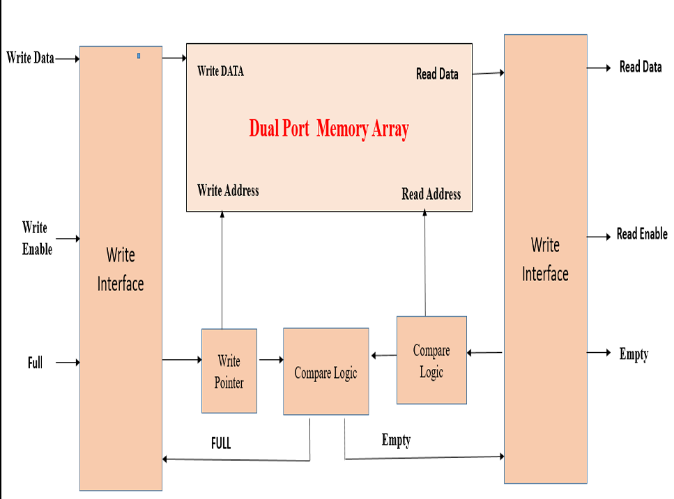
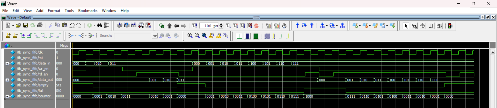
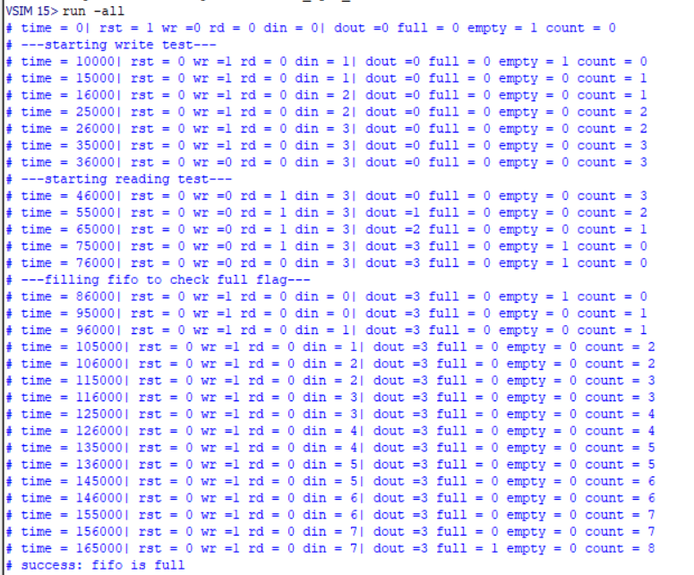
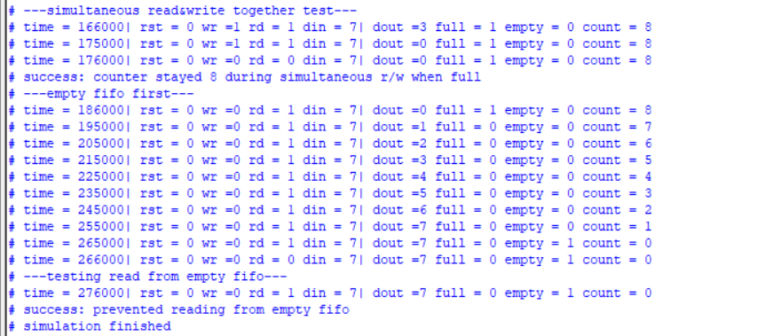

# Synchronous FIFO Design & Verification (Verilog)

## 📌 Project Overview
This project implements a parameterized **Synchronous First-In-First-Out (FIFO)** memory using a **Dual-Port RAM** architecture in **Verilog HDL**. The design is built to handle data transfer between systems with different processing rates, ensuring reliable data flow and preventing data loss.

## 🚀 Key Features
- **Fully Parameterized:** Configurable `DATA_WIDTH` and `DEPTH`.
- **Dual-Port RAM Architecture:** Enables simultaneous Read and Write operations.
- **Robust Flags Logic:** Accurate `full` and `empty` flag generation.
- **Safe Operations:** Prevents overflow (writing when full) and underflow (reading when empty).
- **Simultaneous R/W:** Handles reading and writing concurrently, even when the FIFO is full.

## 🛠️ Tools Used
- **Language:** Verilog HDL
- **Simulation:** ModelSim

## 📂 File Structure
- `sync_fifo.v`: The main RTL design of the FIFO.
- `tb_sync_fifo.v`: Comprehensive Testbench covering all corner cases.

## 🧪 Verification & Test Scenarios
The testbench verifies the design through the following scenarios:
1. **Normal Write & Read:** Ensures data is written and read in the correct FIFO order.
2. **Full Flag Test:** Fills the FIFO to maximum capacity to verify the `full` flag.
3. **Empty Flag Test:** Empties the FIFO completely to verify the `empty` flag.
4. **Simultaneous Read/Write:** Verifies the internal counter remains stable during concurrent operations.
5. **Underflow Protection:** Attempts to read from an empty FIFO.
6. **Overflow Protection:** Attempts to write to a full FIFO.

## 📊 Simulation Results

### Block Diagram

### Waveform

### Console Output (Transcript)

